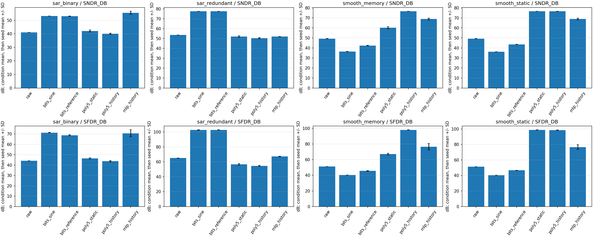
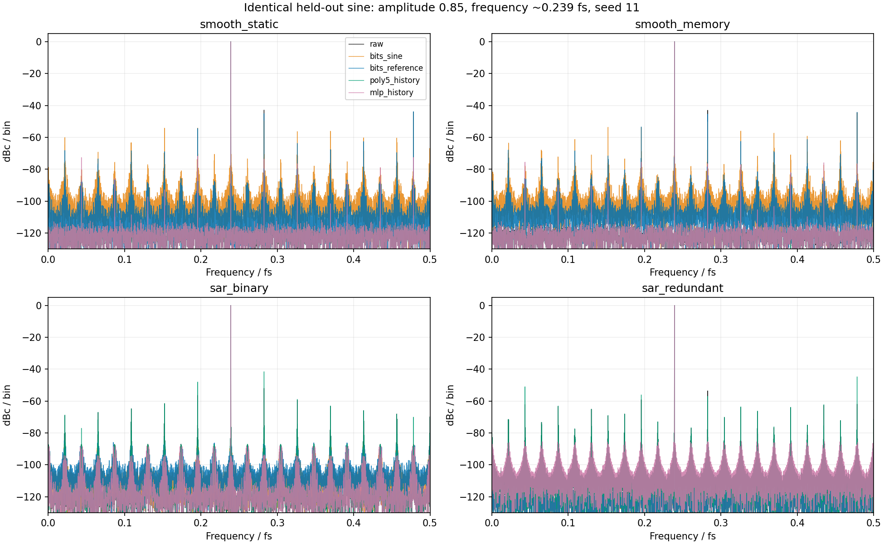

# 位权、多项式与 MLP：校正前后 SNDR／SFDR 对照

> 本文保留原实验预算和数值；PR 将入口移至 `12_foreground`，源码哈希仍记录原运行版本。
> 独立提交分支的验证与迁移说明见 [PR 验证记录](2026-11-02-foreground-pr.md)。

> 本文平滑静态／记忆两行对应已移除的自建模型，保留为历史记录。
> 当前原仓库模型的结果见[统一模型重跑](2026-11-02-foreground-repository-models.md)。
> 本次替换不改变本文独立 SAR 位权失配模型，也不改变后续联合校准模型。

后续已完成 [同一器件同时包含两种误差的串联联合校准实验](2026-11-02-combined-foreground.md)，
包括仅位权、仅多项式／MLP和位权＋多项式／MLP的同采集对照。

日期：2026-11-02。完成四种行为器件×三个随机种子，合计 12 个 case、1326 条冻结测试结果。
本次比较使用同一采集记录的校正前／校正后数据。测试指标均在独立测试输出上重新计算，
不采用训练拟合误差冒充 SNDR，也不按测试结果重新选择参数。

## 实验对象和对照方法

两类器件分别回答平滑非线性校正和真实位决策重加权的问题：

| 器件 | 模型与误差 | 位权方法的输入 |
| --- | --- | --- |
| 平滑静态 | 原 `u=.99x+.015x²+.04x³`，加噪声、14-bit 量化 | 从最终量化码拆出的 14 个二进制列；没有额外内部观测 |
| 平滑＋记忆 | 上述非线性后叠加 `.04u[n-1]` | 同上，仅当前码，不含历史位 |
| 严格二进制 SAR | 14 个 CDAC 权重，实际 MSB 比标称大 1% | 转换器产生的 14 个内部位决策 |
| 冗余 SAR | 重复第三大权重，共 15 次决策，实际 MSB 大 1% | 15 个内部位决策；不能简单等同于最终数字码拆位 |

SAR 使用公开 `sar_convert` 模型，权重以“总和＋一个 LSB”归一化，范围 [-1,1]，
采样噪声 RMS=1e-5；没有比较器噪声、额外平滑非线性或记忆误差。
同一 MSB +1% 误差用于三个种子；种子改变激励、噪声和训练初始化，不是失配 Monte Carlo。
冗余结构的归一化 LSB 与二进制结构不同，不能将它们看作相同量化器只换数字算法。

| 方法 | 拟合方式 | 公平性约定 |
| --- | --- | --- |
| 原始输出 | 标称权重／原始量化码 | 所有方法共享该次转换 |
| 正弦位权 | 现有 `calibrate_weight_sine`，已知频率，`harmonic_order=1`，不搜索频率 | 从训练集选择输入幅度最大的单音，全 8192 点，无外部标签；是单独的实用校准协议 |
| 同参考位权 | `offset + Σw_j b_j[n]`，degree=1、ridge=1e-10 | 与多项式／MLP 使用完全相同的训练行及参考标签 |
| 静态五阶 | 当前标称输出→参考，六系数 | 输入为标量输出 |
| 历史五阶 | 当前输出＋前三拍→参考，126 系数 | 包含全部五阶以内交叉项 |
| 历史 MLP | 四输入，16 个 tanh 单元，冻结仿射基线＋残差 | 验证集选择参数，测试时冻结 |

同参考位权是主要的相同样本预算对照；正弦位权没有使用相同数量的训练行或外部标签，
因此单列报告。正弦位权按标称权重总和确定尺度，并移除拟合 DC；该尺度不影响 SNDR／SFDR，
但不建立绝对增益准确度。SAR 位权方法能访问内部决策，标量多项式／MLP 不能，
这项观测差异必须与结果一起阅读。冗余决策的不同组合可能产生同一个标称输出值。

## 训练与测试预算

- 平滑器件：保留此前混合训练模型，不重新训练多项式／MLP。400×8192 点、stride=16，
  204,800 行训练；独立参考监测通道的已知频率投影生成标签。新增同参考位权重放完全相同的训练记录。
  原 MLP 预算为 200 次。
- SAR：每次 64×8192 点训练、stride=8，共 65,536 行；八条独立验证记录，共 8192 行。
  训练／验证均各半单音与双音，频率与测试分离。参考监测通道为 16-bit、RMS 噪声 2e-4，
  标称单位增益与同步采样。MLP L2=1e-6，预算增至 1000 次。
- 单音测试：幅度 0.1/0.5/0.85，频率约 0.031/0.113/0.239/0.371/0.467 fs，
  共 15 个条件，每条 8192 个有效点。0.467 fs 超出训练上限约 0.45 fs。
- 多音测试：原双音和三音条件，单列计算。全组没有过载。所有训练与校正均不读取模拟真值；
  真值只供绝对误差指标计算。

平滑组复用了此前的测试，属于追加方法的诊断对照；新增 SAR 组没有按测试分数调整模型。
不同器件的预算不同，不是同一器件上 200→1000 次迭代的受控收敛实验。

## 单音校正前后结果

每格为 **SNDR／SFDR，dB，越大越好**。先平均每个种子的 15 个单音条件，
再平均三个种子；种子标准差和逐条件结果保存在 CSV。不同方法列均使用相同测试采集。

| 器件 | 原始输出 | 正弦位权 | 同参考位权 | 静态五阶 | 历史五阶 | 历史 MLP |
| --- | ---: | ---: | ---: | ---: | ---: | ---: |
| 平滑静态 | 49.33／51.27 | 36.25／40.36 | 43.57／46.65 | 76.60／98.74 | 76.57／98.41 | 68.87／76.66 |
| 平滑＋记忆 | 49.29／51.23 | 36.47／40.38 | 42.36／45.57 | 60.23／67.12 | 76.54／98.14 | 68.82／76.53 |
| 严格二进制 SAR | 41.05／44.12 | 53.17／71.28 | 53.02／68.80 | 42.13／46.47 | 40.04／43.69 | 55.57／70.65 |
| 冗余 SAR | 53.71／65.01 | 77.54／102.69 | 77.54／102.74 | 52.01／56.67 | 50.47／54.58 | 51.95／67.16 |



整体均值会掩盖幅度依赖。以下固定峰值幅度为 **0.85**，平均五个频点和三个种子，
仍按 SNDR／SFDR 报告，不重新拟合模型：

| 器件 | 原始输出 | 正弦位权 | 同参考位权 | 静态五阶 | 历史五阶 | 历史 MLP |
| --- | ---: | ---: | ---: | ---: | ---: | ---: |
| 平滑静态 | 40.42／42.92 | 41.57／44.25 | 41.13／43.95 | 84.48／101.69 | 84.39／100.84 | 68.20／73.20 |
| 平滑＋记忆 | 40.40／42.93 | 41.68／44.14 | 41.21／43.90 | 50.07／51.13 | 84.30／100.26 | 66.85／72.00 |
| 严格二进制 SAR | 48.81／51.99 | 64.57／86.57 | 63.94／83.48 | 48.80／53.11 | 42.61／44.52 | 66.84／83.02 |
| 冗余 SAR | 49.66／53.60 | 85.29／110.99 | 85.30／111.13 | 49.80／55.58 | 45.87／50.12 | 63.64／85.36 |



频谱图固定种子 11、幅度 0.85、频率约 0.239 fs，各输出按自身基波归一化为 dBc。
它展示杂散与噪声，不用于证明输出绝对增益正确；曲线没有进行幅度／相位拟合校正。

## 多音结果与指标定义

单音采用相干采样、矩形窗、移除 DC、完整 Nyquist 带宽。
SNDR 为基波功率／其余非 DC 总功率，包含所有谐波；SFDR 为基波功率／最大非期望谱线功率。
单边功率对 Nyquist bin 不加倍。不排除谐波来抬高 SNDR。

多音采用“总期望音功率／剩余功率”和“最强期望音／最大非期望谱线”，单位 dB。
这些行的 `sndr_db`、`sfdr_db` 留空，使用 `spectral_ratio_db`、`spur_ratio_db`，
不将第二个业务音当杂散，也不把该定义冒充单音测量。
落在业务音频点之外的互调包含在分母；与业务音重合的失真无法从该 FFT 单独分离。

| 器件 | 原始输出 | 正弦位权 | 同参考位权 | 静态五阶 | 历史五阶 | 历史 MLP |
| --- | ---: | ---: | ---: | ---: | ---: | ---: |
| 平滑静态 | 41.19／47.07 | 37.82／47.23 | 42.77／47.14 | 79.70／103.09 | 79.71／102.98 | 70.66／81.32 |
| 平滑＋记忆 | 41.39／47.14 | 38.13／47.28 | 42.61／47.25 | 55.40／62.08 | 79.68／103.50 | 71.30／82.84 |
| 严格二进制 SAR | 42.02／48.09 | 55.75／77.72 | 55.80／78.36 | 45.24／56.70 | 44.76／55.77 | 58.63／81.12 |
| 冗余 SAR | 42.77／51.33 | 80.63／103.92 | 80.65／103.90 | 45.65／58.24 | 45.31／57.75 | 53.57／77.74 |

## 结果解释与适用边界

1. 平滑非线性适合直接多项式逆映射；纯静态时六系数已经足够。重新加权最终二进制码
   的表达能力不同，在本例全幅度分布拟合后可能引入小信号阶跃误差，平均 SNDR 甚至下降。
   这不能推导出物理 SAR 位权校准无效。
2. 冗余 SAR 的 MSB 误差有明确的位权结构。两种位权拟合均接近已知实际权重重构的控制结果
   （全单音平均 77.54／102.75 dB）。标量多项式／小型 MLP 既不直接表示位权结构，
   也失去了部分冗余决策信息，本次效果较差，部分低幅度工作点出现退化。
3. 严格二进制 SAR 的正 MSB 误差会产生转换间隙。已知实际权重重构仍只有平均
   52.91／71.46 dB；数字重加权不能补回全部丢失分辨率。该控制不是全局最优下界：
   历史 MLP 可以利用训练信号分布和邻近样本作不同估计，因此局部／平均谱比可能超过它。
4. 六次新 SAR MLP 均达到 1000 次迭代上限，未满足优化器收敛判据。二进制模型选择
   992–1000 次的验证最优点，冗余模型选择 749–988 次。结果只代表此结构和预算，
   不能据此宣称神经网络已经充分优化；也不能保证继续训练会追平位权方法。
5. SNDR／SFDR 对整体增益与基波相位不敏感。尤其在记忆模型中，谱线改善不等于绝对输入恢复。
   CSV 保留不作增益、相位、DC 对齐的 `error_snr_db`。本次全部为行为仿真，无新增芯片实测。

## 代码、核对和复现

正式示例：[exp_cal10_foreground_bitweights.py](../../python/src/adctoolbox/examples/12_foreground/exp_cal10_foreground_bitweights.py)。
接口与观测约定：[FOREGROUND_BITWEIGHTS.md](../../python/src/adctoolbox/examples/12_foreground/FOREGROUND_BITWEIGHTS.md)。
冻结重放：[audit_foreground_bitweights.py](../../python/src/adctoolbox/examples/12_foreground/audit_foreground_bitweights.py)。
原理、参考通道条件与既有实测论文边界仍见
[FOREGROUND_THEORY.md](../../python/src/adctoolbox/examples/12_foreground/FOREGROUND_THEORY.md)。

在 `python/` 下执行本次正式实验：

```bash
uv run python src/adctoolbox/examples/12_foreground/exp_cal10_foreground_bitweights.py --smooth-baseline src/adctoolbox/examples/12_foreground/output/foreground_acceptance_20261101 --smooth-mixed src/adctoolbox/examples/12_foreground/output/excitation_mlp_acceptance_20261102 --output src/adctoolbox/examples/12_foreground/output/bitweight_spectral_acceptance_20261102
uv run python src/adctoolbox/examples/12_foreground/audit_foreground_bitweights.py --directory src/adctoolbox/examples/12_foreground/output/bitweight_spectral_acceptance_20261102 --output bitweight_spectral_audit.json
```

如果没有此前保存的平滑模型，省略两个 `--smooth-*` 参数即可独立运行 SAR 部分。

验证结果：

- 12 个 case、1326 条指标重放通过；独立完整复数 FFT 对单边 FFT 的最大差异
  为 2.69e-11 dB。1170 条单音结果全部与公开频谱分析器一致，没有基波识别歧义。
- 训练／验证／测试频率分离、保存的验证最优点、输入与源码哈希、汇总统计核对通过；无过载。
- 相关测试 73 通过、1 跳过（Windows 符号链接权限）。三条已有 warning 分别来自
  尺度控制测试的超量程示例及两条正弦拟合迭代提示；新实验测试无 warning。
- Sphinx 严格构建通过；wheel／sdist 包含新脚本和文档。解包 wheel 后完成小规模实验、
  238 条结果重放、示例复制和临时目录技能安装／同步检查。

提交用工件：
[汇总 CSV](bitweight-spectral-summary-20261102.csv)、
[逐条件 CSV](bitweight-spectral-tests-20261102.csv)、
[配置／诊断／核对证据](bitweight-spectral-evidence-20261102.json)。
完整模型、采集清单、源代码快照和频谱在示例 `output/bitweight_spectral_acceptance_20261102/`；
测试、构建和分发核对日志在 `agent_playground/bitweight_spectral_20261102/`。
原验收阶段未执行 commit、push 或发布。
