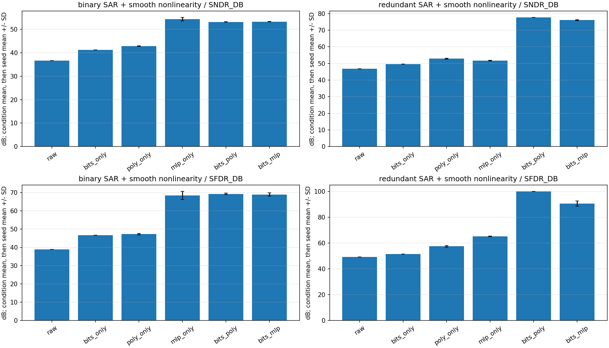
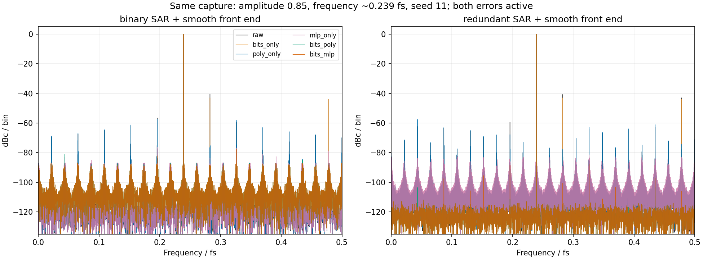
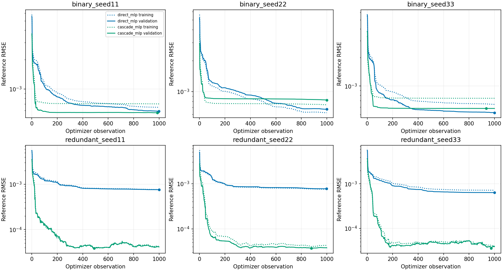

# 同一器件内位权失配与平滑非线性的联合校准

> 本文保留原实验预算和数值；PR 将入口移至 `12_foreground`，源码哈希仍记录原运行版本。
> 独立提交分支的验证与迁移说明见 [PR 验证记录](2026-11-02-foreground-pr.md)。

日期：2026-11-02。完成两种 SAR 结构×三个种子，108 条测试采集、972 条方法结果。
所有正常训练、验证、测试均同时包含两种误差。这里的“联合”是先辨识位权、再训练剩余
非线性，运行时串联两级冻结校正；没有联合优化位权和网络的梯度。

## 误差构造与原有代码复用

实际信号链为：

```text
x → 原有静态非线性接口 f(x) → 带 MSB 失配的原有 SAR 转换器 → 内部位决策 b
                                                        ↓
                                      标称／校准位权重构 → 可选多项式／MLP
```

| 模块 | 本次使用的原有接口与参数 |
| --- | --- |
| 平滑非线性 | `ADC_Signal_Generator.apply_static_nonlinearity`，DC=0、k2=.015、k3=.04，因此 u=x+.015x²+.04x³ |
| SAR | `sar_ideal_weights`、`sar_convert`、`sar_reconstruct`，量程 [-1,1]，实际 MSB 权重增加 1% |
| 严格二进制结构 | 14 个权重／14 次决策 |
| 冗余结构 | 重复第三大权重，15 次决策；按权重总和＋一个 LSB 归一化 |
| 参考监测量化 | 原有 `apply_quantization_noise`，16-bit，另加半 LSB 成为中点表示 |
| 噪声 | SAR 输入采样噪声 1e-5 RMS；独立监测噪声 2e-4 RMS，独立确定性 RNG |

没有修改上述原有误差／SAR 实现。与此前自行组合的 `.99x+.015x²+.04x³` 基准不同，
这次直接使用原有静态非线性接口，线性项系数为 1。没有额外注入记忆、比较器噪声、
参考纹波或时序误差。三个种子改变采集与初始化，MSB 误差固定，不是芯片失配 Monte Carlo。

## 位权如何获取，串联如何训练

第一步使用一条**绕过非线性前端、直接注入 SAR 输入端**的独立正弦，峰值 0.9、8192 点。
调用现有 `calibrate_weight_sine`，给定频率、`harmonic_order=1`、不搜索频率。
利用独立参考监测通道拟合出的幅度和 DC 确定权重尺度与偏置，未使用模拟真值或实际电容值。
得到并冻结：

```text
z[n] = offset + sum(w_i * b_i[n])
```

第二步在完整器件上采集单音／双音混合训练记录，用同一位决策生成标称输出 y 和校准输出 z。
分别训练 y→r 的单独多项式／MLP，以及 z→r 的串联多项式／MLP。r 来自输入端独立参考监测
通道的已知频率投影。校正时使用已保存参数，模型不再读取 r，不更新位权或网络参数。

该流程的优势有条件：位权路径获得了**内部位决策、专用注入通路及额外 8192 点校准采集**。
单独多项式／MLP 只访问标称标量输出。各非线性拟合器的完整器件训练数据相同，但不能称为
所有方法具有相同的总观测成本。旁路模式必须保持正常工作时的 SAR 权重和参考行为。

## 数据、模型与指标

- 每 case 64 条训练、八条验证记录，每条 8192 点，stride=8；分别为 65,536 和 8192 行。
  单音与双音各占一半，峰值预算 0.05–0.90，频率约 0.02–0.45 fs。
- 位权校准、训练、验证和测试频率分离；采集噪声种子分离。真值只进入器件和评估器。
- 误差是静态的，因此多项式／MLP 均只接收**当前一个标量输入，无历史**。
  多项式五阶、六系数、ridge=1e-10；MLP 16 个 tanh 单元，49 个网络参数＋两个冻结仿射参数，
  L2=1e-6，最多 1000 次 L-BFGS-B 迭代。两条 MLP 路径使用相同大小、预算和初始化种子。
- 单音测试为幅度 0.1/0.5/0.85 ×约 0.031/0.113/0.239/0.371/0.467 fs；最后一频点超出训练带宽。
  另测双音、三音、五音，共每 case 18 条。所有方法使用完全相同的测试采集，均无过载。
- 单音采用相干采样、矩形窗、完整 Nyquist 带宽、去 DC；SNDR 分母包含全部非期望功率，
  包括谐波；SFDR 使用最大非期望谱线。没有用训练残差替代频谱测量。
- 以下先在每个种子内平均条件，再平均种子；完整 CSV 同时保留种子标准差和逐条件结果。
  测试不进行额外增益、相位、偏置拟合，`error_snr_db` 也保留在 CSV。

这里的标量 MLP 与上一轮四输入历史 MLP 不同，不能将差异归因于单独增加训练迭代。
部分测试网格沿用此前诊断实验，不宣称对所有应用波形的盲测或普遍保证。

## 校正前后：单音 SNDR／SFDR

每格为 **SNDR／SFDR，dB**，平均 15 个单音条件及三个种子。

| 方法 | 严格二进制 SAR＋非线性 | 冗余 SAR＋非线性 |
| --- | ---: | ---: |
| 未校准 | 36.61／38.91 | 46.75／49.22 |
| 仅位权 | 41.25／46.62 | 49.51／51.37 |
| 仅五阶多项式 | 42.84／47.27 | 52.81／57.43 |
| 仅 MLP | 54.36／68.38 | 51.71／65.15 |
| 位权＋五阶多项式 | 53.16／69.23 | **77.66／99.92** |
| 位权＋MLP | 53.27／68.90 | **76.05／90.56** |



固定峰值幅度 **0.85**，仅平均五个频点和三个种子，结果为：

| 方法 | 严格二进制 SAR＋非线性 | 冗余 SAR＋非线性 |
| --- | ---: | ---: |
| 未校准 | 38.62／40.37 | 38.56／40.76 |
| 仅位权 | 40.44／42.95 | 40.51／43.01 |
| 仅五阶多项式 | 51.09／56.01 | 51.45／56.71 |
| 仅 MLP | 65.30／79.45 | 63.25／81.93 |
| 位权＋五阶多项式 | 64.45／79.83 | **85.55／102.54** |
| 位权＋MLP | 64.40／78.72 | **81.11／87.84** |



频谱图固定种子 11、幅度 0.85、频率约 0.239 fs；各输出按自身基波归一化为 dBc，
只用于展示杂散和噪声，不据此宣称绝对增益准确。

## 多音迁移与辨识方式对照

以下两项依次为“总期望音功率／剩余非 DC 功率”和“最强期望音／最大非期望谱线”，单位 dB，
平均双音、三音、五音及三个种子。它们与单音 SNDR／SFDR 分开命名，CSV 的单音字段留空。

| 方法 | 严格二进制 SAR＋非线性 | 冗余 SAR＋非线性 |
| --- | ---: | ---: |
| 未校准 | 36.58／43.25 | 36.58／44.10 |
| 仅位权 | 41.61／48.43 | 42.39／48.92 |
| 仅五阶多项式 | 43.22／54.60 | 43.74／56.48 |
| 仅 MLP | 55.33／76.61 | 51.68／74.81 |
| 位权＋五阶多项式 | 53.47／74.98 | 79.38／101.90 |
| 位权＋MLP | 53.70／76.32 | 78.71／97.06 |

另设置不经过旁路校准、直接对完整器件参考拟合线性位权，再接多项式的对照。
它们与主要串联方案的参数获取方式不同。以下仍为全单音平均 SNDR／SFDR：

| 对照 | 严格二进制 | 冗余 |
| --- | ---: | ---: |
| 位决策直接拟合完整链路参考 | 40.74／46.00 | 48.62／53.95 |
| 冻结上述权重后再接五阶多项式 | 46.65／55.61 | 50.68／57.12 |
| 已知实际权重＋已知三次函数逆，仅评估器可用 | 52.93／71.48 | 77.74／103.70 |

这说明在本模型和训练设置下，直接把两种误差都压到一次位权拟合中，再接一个多项式，
不等价于先分离辨识位权。它不证明所有无旁路联合算法都无效；带约束的联合优化尚未测试。
已知权重控制不是信息论最优下界：它采用一种固定的码区间重构，其他估计器可能在特定
输入分布上超过其某个指标，但这不代表恢复了所有丢失信息。

## MLP 训练状态



十二次训练均报告 `STOP: TOTAL NO. OF ITERATIONS REACHED LIMIT`，即到达 1000 次预算，
未满足优化器收敛容差。所有模型都采用独立验证 MSE 最小的已观察参数点，而不是强制取末次。
冗余串联 MLP 的验证最优点分别为 489、879、974 次，验证 RMSE 约 3.85e-5、3.72e-5、3.57e-5。
因此不能用“未收敛”解释为没有有效校正，也不能假定继续迭代必然更好。
当前结果仍只代表此网络、数据与预算，没有进行按测试成绩调参。

## 结论和适用范围

1. **在有纠错余量的冗余 SAR 中，组合校准有明确收益。** 位权先恢复正确重构，再由
   多项式／MLP处理剩余平滑失真。此处六系数多项式已经接近已知参数控制的 SNDR。
2. **严格二进制的转换间隙仍是限制。** 串联模型改善了原始输出，但并未普遍超过单独 MLP，
   不能声称“联合一定最好”或能弥补任意丢码。
3. **硬件观测和校准顺序是结果的一部分。** 主方案需要内部位决策、SAR 输入端专用注入／旁路，
   和额外一条校准采集。最终码已经合并掉的冗余决策信息，标量后校正未必能恢复。
4. **仅验证静态、稳定、可逆前端。** 尚未测试记忆效应、PVT、不同 DC 工作点、随机抖动、
   参考通道增益／带宽误差或削顶恢复。旁路不可实现，或非线性位于 ADC 内部其他级时，
   需要重新设计可辨识的校准工况，不能直接套用此流程。
5. **仍为行为仿真。** 原有模型复用不等于晶体管级验证或实测芯片背书。联合校准的已发表
   电路实践与本例区别见 [COMBINED_FOREGROUND.md](../../python/src/adctoolbox/examples/12_foreground/COMBINED_FOREGROUND.md)
   中的 Verma／Razavi 2009 全文及 Li 等 2026 出版商公开描述。没有新增定点、功耗或吞吐测量。

## 复现、工件与验收

正式代码：[exp_cal11_combined_foreground.py](../../python/src/adctoolbox/examples/12_foreground/exp_cal11_combined_foreground.py)。
运行与接口说明：[COMBINED_FOREGROUND.md](../../python/src/adctoolbox/examples/12_foreground/COMBINED_FOREGROUND.md)。
重放核对：[audit_combined_foreground.py](../../python/src/adctoolbox/examples/12_foreground/audit_combined_foreground.py)。

在 `python/` 下运行，不需要此前保存的模型：

```bash
uv run python src/adctoolbox/examples/12_foreground/exp_cal11_combined_foreground.py --output src/adctoolbox/examples/12_foreground/output/combined_foreground_acceptance_20261102
uv run python src/adctoolbox/examples/12_foreground/audit_combined_foreground.py --directory src/adctoolbox/examples/12_foreground/output/combined_foreground_acceptance_20261102 --output combined_foreground_audit.json
```

- 972 条结果全部冻结重放通过，模型字典未被推理修改；108 条测试均同时含两种误差，无过载。
- 独立完整复数 FFT 与单边 FFT 最大差异 4.21e-11 dB；810 条单音结果均与公开分析器核对一致。
- 数据频率分离、验证选择、源快照哈希、汇总统计核对通过。
- 相关测试 73 通过、1 个 Windows 符号链接权限跳过。三条已有 warning 来自尺度控制和正弦拟合示例。
- Sphinx 严格构建通过；wheel／sdist 包含新示例、审计脚本及文档。从解包 wheel 完成
  小规模联合实验和 324 条结果核对，示例复制、临时目录技能安装与同步检查通过。

版本库工件：[汇总 CSV](combined-foreground-summary-20261102.csv)、
[逐条件 CSV](combined-foreground-tests-20261102.csv)、
[配置、诊断与验证证据](combined-foreground-evidence-20261102.json)。
完整模型、清单、训练曲线及源代码快照保存在示例的 `output/combined_foreground_acceptance_20261102/`；
构建包与验证日志在 `agent_playground/combined_foreground_20261102/`。没有执行 commit、push 或发布。
