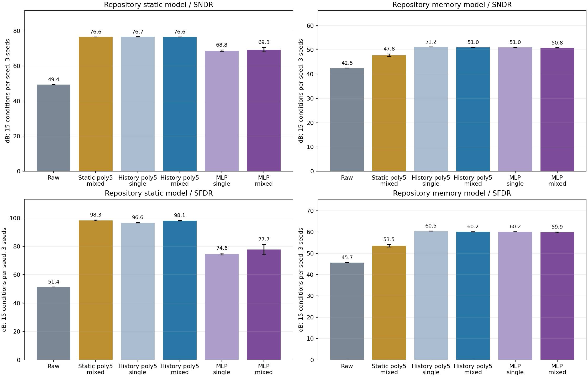
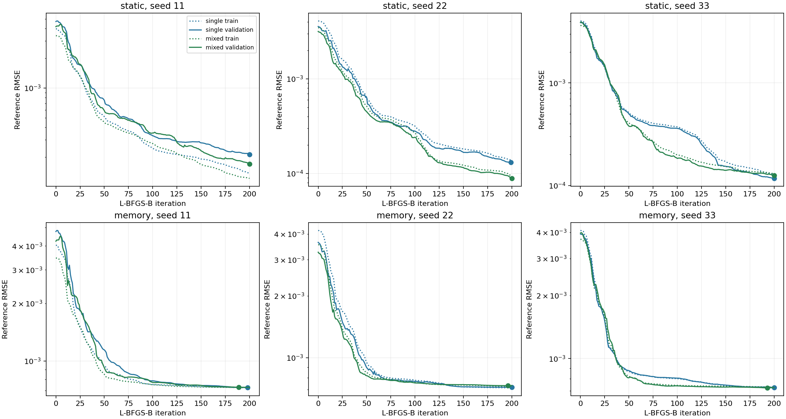

# 原仓库非线性／记忆模型：替换与重跑

> 本文保留原实验预算和数值；PR 将入口移至 `12_foreground`，源码哈希仍记录原运行版本。
> 独立提交分支的验证与迁移说明见 [PR 验证记录](2026-11-02-foreground-pr.md)。

日期：2026-11-02。本报告取代早期自建 `NonlinearFrontend` 的前台性能结论。
旧报告、CSV 和原始源码快照保留为历史记录；不覆盖、不混用旧模型参数。

## 模型来源与删除范围

已删除 `foreground_benchmark.py` 中的 `NonlinearFrontend` 类和 FIR 实现。
该文件只保留配置、采集、参考投影、数据集组织；不再自建器件非线性或记忆算法。

| 环节 | 当前调用 | 条件 |
| --- | --- | --- |
| 静态非线性 | 原 `ADC_Signal_Generator.apply_static_nonlinearity` | `k2=.015, k3=.04` |
| 记忆 | 原 `apply_memory_effect` | `memory_strength=.04`；静态组完全绕过该接口 |
| DUT 量化 | 原 `apply_quantization_noise` | 14 bit、[-1,1]，加半 LSB 表示码中心 |
| 参考量化 | 同上 | 16 bit；独立随机噪声后进行已知频率投影 |

未修改原 `siggen/nonidealities.py` 或原 SAR 模型。该非理想信号模块自 2025-12-17 已存在。
噪声仍用独立 seeded NumPy RNG（DUT 1e-5 RMS、monitor 2e-4 RMS），避免原噪声接口的全局 RNG。
参数、串联顺序和训练设计仍是本实验选择；复用代码不等于经过硅验证，也不消除模型选择偏向。

静态路径为 `u=x+.015*x²+.04*x³`。记忆接口的实际计算为：

```text
q[n] = floor(16*u[n])/16
l[n] = floor(4096*(u[n]-q[n]))/4096
v[n] = q[n]+l[n]+.04*q[n-1]
```

因此原记忆模型包含粗／细量化和码相关反馈，不能称为旧模型的线性 FIR。
即使强度为零，该接口仍执行量化，所以静态组必须绕过它。源码中的 `msb`（这里的 `q`）
实际是步长 1/16 的粗量化值，不是仅有 0/1 的单个 MSB，也不是完整带饱和的 ADC 级。
记忆接口使用 `np.roll`，回绕的第一个点被预热裁切丢弃。
每条记录先生成 64 个预热点和 3 个历史点，最终正好评价 8192 点；没有伪造连续分块状态。
在该量程下，粗码反馈阶跃为 `.04/16 = .0025`，约为最终 14-bit 量化 LSB 的 20.48 倍；
内部细量化步长为 `1/4096`，是最终 LSB 的 2 倍。这些机制不在旧 FIR 中。
较低成绩不能仅归因于优化器未收敛，也不能据此声称所有带记忆 ADC 都有相同上限。

默认线性输入增益从旧模型 .99 改为 1，与原静态 API 和联合校准实验一致。
漂移压力组在原静态接口前施加输入增益 ×1.02，同时 k3 ×1.5；不参与常规性能均值。
这不是只改变记忆项的单变量消融，不能把新旧分数差异全部归因于记忆。

## 预算与指标

保持早期正式验收预算：两种器件、种子 11/22/33；每 case 400×8192 点训练，stride=16，
得到 204,800 行；40 条验证记录得到 20,480 行。原单音训练和半单音／半双音训练均重跑。
MLP 四输入、16 个 tanh 单元，200 次 L-BFGS-B 上限、L2=1e-6；五阶历史多项式 126 系数，
静态五阶 6 系数、ridge=1e-10。全部超参数固定，验证集选 MLP 迭代，测试集不参与选择。
三个种子改变激励、噪声和初始化，器件参数固定，不是芯片 Monte Carlo。

训练／验证／测试频率分离；训练峰值预算 .05–.90，频率约 .02–.45 fs。
单音测试为幅度 .1/.5/.85 × 五个频率，含 .467 fs 外推点。每种子先平均 15 个条件，
再报告三个种子均值 ± 样本标准差。SNDR 包含全部谐波和噪声，SFDR 使用最大非期望谱线；
相干矩形窗，去 DC，覆盖全 Nyquist 带，不重复加倍 Nyquist 点，不对测试输出拟合增益或相位。

## 当前单音校正前后：SNDR／SFDR

单位 dB。所有方法比较同一条测试采集；单音／混合指训练激励。

| 方法 | 静态 SNDR | 静态 SFDR | 记忆 SNDR | 记忆 SFDR |
| --- | ---: | ---: | ---: | ---: |
| 未校准 | 49.43 ± 0.00 | 51.39 ± 0.01 | 42.50 ± 0.00 | 45.71 ± 0.00 |
| 混合训练静态五阶 | 76.64 ± 0.02 | 98.32 ± 0.28 | 47.81 ± 0.54 | 53.51 ± 0.64 |
| 单音训练历史五阶 | 76.69 ± 0.01 | 96.62 ± 0.16 | 51.20 ± 0.01 | 60.46 ± 0.06 |
| 混合训练历史五阶 | 76.62 ± 0.03 | 98.10 ± 0.24 | 51.02 ± 0.02 | 60.15 ± 0.06 |
| 单音训练 MLP | 68.75 ± 0.39 | 74.58 ± 0.72 | 50.96 ± 0.03 | 60.18 ± 0.00 |
| 混合训练 MLP | 69.33 ± 1.30 | 77.73 ± 3.55 | 50.84 ± 0.01 | 59.89 ± 0.20 |

在本组固定参数下，静态五阶已接近历史五阶的静态器件表现，没有必要仅为静态误差增加历史。
原记忆器件中，历史五阶和当前 MLP 都改善了未校准输出，但没有恢复到静态器件的水平。
这不是两类方法对任意 ADC 的性能排序。



## 原双音／三音／五音表：重新采集与冻结测试

重跑 72 条随机记录：两种器件 × 三种子 × 双／三／五音 × 每组四条。
沿用预先固定的随机种子、生成规则与预算；排除全部训练、验证、原测试频率。
这些是独立采集和频率保留测试，不宣称人从未看过该测试设计的新盲测。
所有常规测试无过载。下表为未做增益、相位、DC 对齐的**绝对误差 SNR**（dB），
用于和旧表相同的口径比较，不能把它改名为 SNDR。

| 器件／测试 | 未校准 | 混合静态五阶 | 单音历史五阶 | 混合历史五阶 | 混合 MLP |
| --- | ---: | ---: | ---: | ---: | ---: |
| 静态／2 音 | 40.08 ± 3.90 | 78.14 ± 2.50 | 42.77 ± 5.15 | 78.14 ± 2.49 | 70.86 ± 2.11 |
| 静态／3 音 | 43.82 ± 2.92 | 75.44 ± 1.97 | 42.85 ± 3.79 | 75.44 ± 1.96 | 70.27 ± 2.44 |
| 静态／5 音 | 45.85 ± 1.55 | 73.33 ± 1.19 | 41.57 ± 3.13 | 73.33 ± 1.19 | 69.05 ± 1.04 |
| 记忆／2 音 | 27.71 ± 0.29 | 28.05 ± 0.23 | 32.59 ± 4.62 | 52.25 ± 2.41 | 52.19 ± 2.38 |
| 记忆／3 音 | 27.67 ± 0.45 | 27.91 ± 0.20 | 31.75 ± 2.98 | 49.49 ± 2.00 | 49.46 ± 2.00 |
| 记忆／5 音 | 27.34 ± 0.12 | 28.10 ± 0.22 | 30.89 ± 2.98 | 47.41 ± 1.16 | 47.39 ± 1.14 |

单音训练历史五阶在单音上表现较好，并不代表多音泛化良好；混合训练仍然明显改善多音结果。
记忆器件的混合历史五阶与混合 MLP 在这些多音条件下接近，不能沿用旧 FIR 表中的大幅差距。

同一批多音数据的**总期望音功率／噪声失真功率**与**最强期望音／最大杂散**如下。
每格两个数均为 dB；多音 CSV 的 `sndr_db`、`sfdr_db` 留空，避免与标准单音指标混称。

| 器件／测试 | 未校准 | 混合静态五阶 | 单音历史五阶 | 混合历史五阶 | 混合 MLP |
| --- | ---: | ---: | ---: | ---: | ---: |
| 静态／2 音 | 45.59 / 49.75 | 78.15 / 102.29 | 45.89 / 47.37 | 78.15 / 102.27 | 71.59 / 79.95 |
| 静态／3 音 | 48.51 / 52.75 | 75.45 / 100.31 | 45.42 / 48.44 | 75.45 / 100.34 | 70.96 / 80.97 |
| 静态／5 音 | 49.57 / 55.01 | 73.34 / 97.88 | 43.86 / 49.38 | 73.34 / 97.89 | 69.72 / 82.13 |
| 记忆／2 音 | 43.87 / 49.67 | 51.46 / 65.41 | 35.23 / 37.88 | 52.26 / 70.98 | 52.21 / 70.96 |
| 记忆／3 音 | 44.38 / 52.66 | 48.94 / 64.89 | 33.67 / 38.58 | 49.51 / 70.20 | 49.48 / 70.21 |
| 记忆／5 音 | 43.91 / 54.83 | 47.39 / 67.64 | 32.45 / 40.18 | 47.42 / 68.80 | 47.40 / 68.80 |

## 与旧自建模型的数值对照

下表保留旧 CSV 中相同预算的单音结果，仅说明替换造成的变化；两列对应不同器件。
不能用新旧列的差值评判算法升级，也不能继续引用旧 FIR 表作为当前模型表现。

| 器件 | 方法 | 旧自建模型 SNDR／SFDR | 原仓库模型 SNDR／SFDR |
| --- | --- | ---: | ---: |
| 静态 | 未校准 | 49.33 / 51.27 | 49.43 / 51.39 |
| 静态 | 混合训练静态五阶 | 76.60 / 98.74 | 76.64 / 98.32 |
| 静态 | 混合训练历史五阶 | 76.57 / 98.41 | 76.62 / 98.10 |
| 静态 | 混合训练 MLP | 68.87 / 76.66 | 69.33 / 77.73 |
| 记忆 | 未校准 | 49.29 / 51.23 | 42.50 / 45.71 |
| 记忆 | 混合训练静态五阶 | 60.23 / 67.12 | 47.81 / 53.51 |
| 记忆 | 混合训练历史五阶 | 76.54 / 98.14 | 51.02 / 60.15 |
| 记忆 | 混合训练 MLP | 68.82 / 76.53 | 50.84 / 59.89 |

## 位权对照同步回放

`exp_cal10` 的静态／记忆部分也重跑：重训参考监督位权及单条正弦位权，
多项式／MLP 使用本次保存模型，不再次训练。下面是 15 单音条件的均值，单位 dB。

| 方法 | 静态 SNDR／SFDR | 记忆 SNDR／SFDR |
| --- | ---: | ---: |
| 未校准 | 49.43 / 51.39 | 42.50 / 45.71 |
| 单条正弦位权 | 36.34 / 40.47 | 36.25 / 40.58 |
| 参考监督位权 | 43.29 / 46.66 | 41.06 / 45.26 |
| 混合静态五阶 | 76.64 / 98.32 | 47.81 / 53.51 |
| 混合历史五阶 | 76.62 / 98.10 | 51.02 / 60.15 |
| 混合 MLP | 69.33 / 77.73 | 50.84 / 59.89 |

这里的位列来自最终 14-bit 码拆位，不是额外内部电容观测；不能把拟合权重解释成电容误差。
参考监督位权使用同一批混合训练行和标签；正弦位权使用最高幅度单音的完整一条记录，
其校准协议与监督模型不同。当前码位权没有历史，不能一般性消除跨采样记忆。
独立 SAR 位权失配及 exp_cal11 联合实验的器件未改变，既有数值不因本次替换而重写。

## MLP 诊断与适用范围

本次 12 次 MLP 中 0 次满足优化器收敛条件。
达到 200 次上限表示预算终止，不等于发散，也不等于实际输出不稳定。
使用独立验证误差最低的已观察迭代；不能保证增加迭代会追平其他方法。

| 器件／种子 | 训练激励 | 选择迭代 | 完成迭代 | 优化器收敛 | 验证 RMSE |
| --- | --- | ---: | ---: | --- | ---: |
| static_seed11 | single | 200 | 200 | False | 0.000212898 |
| static_seed11 | mixed | 200 | 200 | False | 0.000170935 |
| static_seed22 | single | 199 | 200 | False | 0.000130801 |
| static_seed22 | mixed | 200 | 200 | False | 8.8666e-05 |
| static_seed33 | single | 200 | 200 | False | 0.000117305 |
| static_seed33 | mixed | 200 | 200 | False | 0.000124733 |
| memory_seed11 | single | 198 | 200 | False | 0.000725284 |
| memory_seed11 | mixed | 189 | 200 | False | 0.000727127 |
| memory_seed22 | single | 200 | 200 | False | 0.000718578 |
| memory_seed22 | mixed | 196 | 200 | False | 0.000731767 |
| memory_seed33 | single | 200 | 200 | False | 0.000727851 |
| memory_seed33 | mixed | 193 | 200 | False | 0.000724401 |



这是提前采集参考、离线训练、运行时冻结参数的数字后校正。适用范围限于已覆盖的
幅度、频率、误差机制和稳定条件。原记忆模型的量化／码反馈含不连续性，
不能保证有限阶平滑多项式或当前 MLP 能完整逆转；扩大历史也需要重新验证激励覆盖。
静态低阶多项式仍是有利于多项式校正的模型族。没有证明任意 ADC、PVT、采样率、长记忆、
失码、过载或随机抖动都可恢复，也没有用本结果证明 MLP 或多项式普遍胜出。
物理论文及其与本实现的差异继续见
[数学与文献说明](../../python/src/adctoolbox/examples/12_foreground/FOREGROUND_THEORY.md)。

## 独立核对与复现

冻结 JSON 重载与独立 full-complex FFT 核对通过：共 2904 行，
最大指标差 1.48e-11 dB，
2040 次公开单音分析器交叉核对。
位权回放另核对 612 行。
校验模型未变、频率分离、常规零过载、聚合统计、验证最优迭代、源码及输入哈希。
模型标识为 `repository_siggen_static_coarse_memory_v1`；旧 manifest 被拒绝，必须使用历史源码复现旧结果。

相关测试 45 项通过、1 项跳过；跳过原因是 Windows 目录符号链接权限。两条警告来自已有正弦拟合的一次迭代示例。
Sphinx 严格构建：passed (-W --keep-going)；wheel／sdist 构建：passed (wheel and sdist)。
安装 wheel 后重跑两种器件的短实验，842 行冻结核对通过；临时技能安装和示例复制通过。


从 `python/` 运行，所有输出目录须为新目录：

```powershell
uv run python src/adctoolbox/examples/12_foreground/exp_cal03_foreground_nonlinear.py --records 400 --validation-records 40 --output src/adctoolbox/examples/12_foreground/output/foreground_repository_20261102
uv run python src/adctoolbox/examples/12_foreground/exp_cal05_foreground_excitation.py --baseline src/adctoolbox/examples/12_foreground/output/foreground_repository_20261102 --retrain-mlp --output src/adctoolbox/examples/12_foreground/output/excitation_repository_20261102
uv run python src/adctoolbox/examples/12_foreground/audit_foreground_transfer.py --baseline src/adctoolbox/examples/12_foreground/output/foreground_repository_20261102 --mixed src/adctoolbox/examples/12_foreground/output/excitation_repository_20261102 --output src/adctoolbox/examples/12_foreground/output/transfer_repository_20261102
uv run python src/adctoolbox/examples/12_foreground/exp_cal10_foreground_bitweights.py --smooth-baseline src/adctoolbox/examples/12_foreground/output/foreground_repository_20261102 --smooth-mixed src/adctoolbox/examples/12_foreground/output/excitation_repository_20261102 --sar-plants --output src/adctoolbox/examples/12_foreground/output/bitweight_repository_20261102
uv run python src/adctoolbox/examples/12_foreground/audit_repository_foreground.py --baseline src/adctoolbox/examples/12_foreground/output/foreground_repository_20261102 --mixed src/adctoolbox/examples/12_foreground/output/excitation_repository_20261102 --fresh src/adctoolbox/examples/12_foreground/output/transfer_repository_20261102 --output ../agent_playground/foreground_repository_20261102/audit.json
```

[逐条单音／原测试结果](foreground-repository-tests-20261102.csv)、
[汇总](foreground-repository-summary-20261102.csv)、
[随机多音逐条结果](foreground-repository-transfer-tests-20261102.csv)、
[随机多音汇总](foreground-repository-transfer-summary-20261102.csv)、
[位权对照](foreground-repository-bitweights-20261102.csv)、
[配置与审计证据](foreground-repository-evidence-20261102.json)。
完整模型、采集 manifest、源码快照保存在各实验输出目录。
本次不修改其他 Dither 器件模型，不执行 commit、push 或发布。
